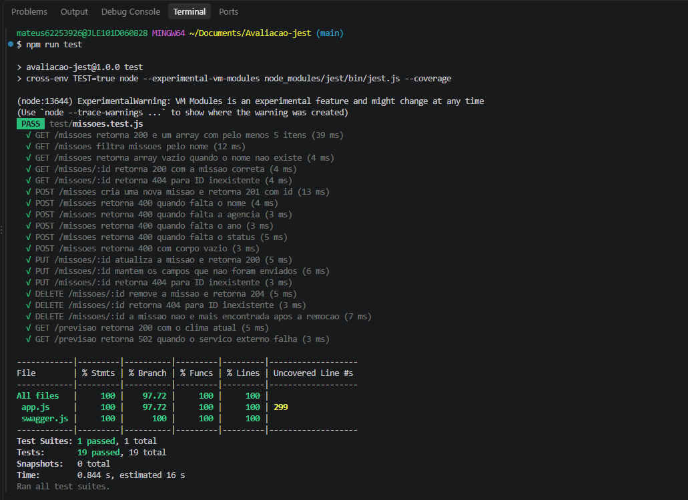
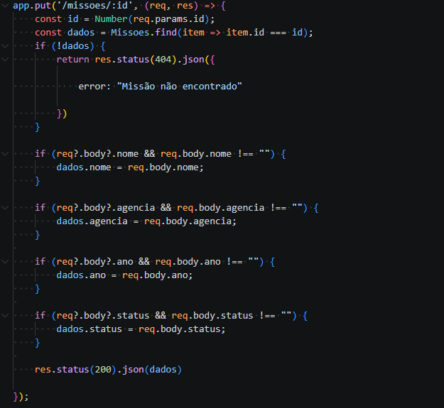
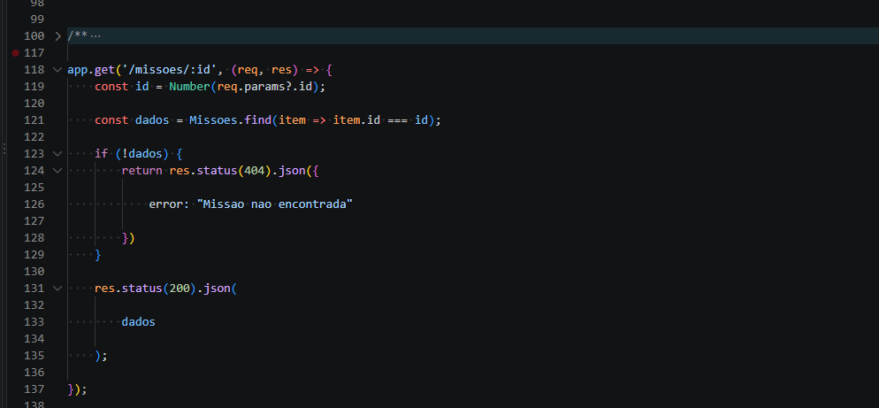
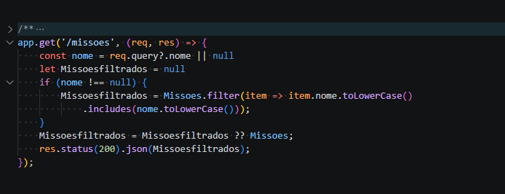
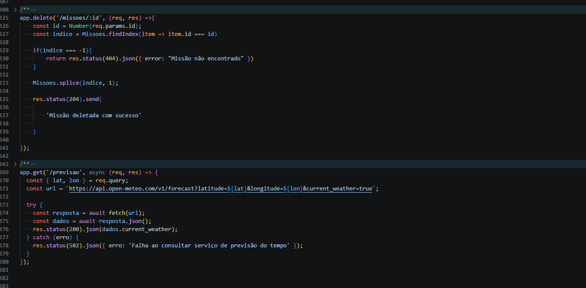

# API REST de Missões Espaciais

## 1. Identificação

- **Nome completo:** Mateus Bohn dos Santos
- **Curso:** Informática para Internet
- **Turma:** 2608
- **Unidade Curricular:** Desenvolver Serviços Web

---

## 2. Descrição do Projeto

API REST desenvolvida em Node.js e Express para o gerenciamento de missões espaciais. Permite **cadastrar, consultar, atualizar e remover** missões (CRUD), com os dados armazenados em memória (array), testes automatizados com Jest e Supertest e documentação interativa com Swagger (OpenAPI 3.0).

Cada missão possui os atributos:

```json
{
  "id": 1,
  "nome": "Ancião",
  "agencia": "Proteção intergalatica",
  "ano": "3000",
  "status": "pendente"
}
```

A aplicação inicia com **5 missões** pré-cadastradas.

---

## 3. Tecnologias Utilizadas

- Node.js
- Express
- CORS
- Jest
- Supertest
- cross-env
- Swagger (`swagger-ui-express` e `swagger-jsdoc`)
- JSON

---

## 4. Como Clonar o Projeto

```bash
git clone https://github.com/mateusbohntb-ai/Avaliacao-jest.git
cd Avaliacao-jest
```

---

## 5. Como Instalar as Dependências

```bash
npm install
```

---

## 6. Como Executar o Projeto

```bash
npm run dev
```

- API disponível em: **http://localhost:3000**
- Documentação Swagger: **http://localhost:3000/docs**

> O servidor é iniciado pelo arquivo `index.js`, e o app Express é criado em `app.js` (exportado sem abrir porta), o que permite ao Supertest importá-lo diretamente.

---

## 7. Como Executar os Testes

```bash
npm test
```

O comando executa o Jest com relatório de cobertura (`--coverage`). Os testes **não precisam do servidor ligado**, pois o Supertest usa o `app` diretamente.

### O que os testes cobrem

Os testes ficam em `test/missoes.test.js`. Como os dados ficam em memória, **antes de cada teste (`beforeEach`) uma nova instância do app é carregada**, recriando o array de missões e garantindo que um teste nunca dependa do estado deixado por outro.

| Rota | Cenários testados |
|------|-------------------|
| `GET /missoes` | 200 e array com ao menos 5 itens; estrutura dos campos; filtro por `nome` (inclusive sem diferenciar maiúsculas/minúsculas); filtro sem resultado retorna `[]` |
| `GET /missoes/:id` | 200 com a missão correta; 404 para ID inexistente; 404 para ID não numérico |
| `POST /missoes` | 201 com a missão criada e `id`; missão aparece na listagem; 400 para cada campo obrigatório ausente; 400 para corpo vazio e string vazia; nada é cadastrado em caso de erro |
| `PUT /missoes/:id` | 200 com a missão atualizada; alteração persistida; atualização parcial mantém os demais campos; 404 para ID inexistente |
| `DELETE /missoes/:id` | 204 ao remover; 404 para ID inexistente; missão não é mais encontrada após remoção; total diminui; segunda remoção retorna 404 |
| `GET /previsao` | 200 com `current_weather` e uso de `lat`/`lon` na URL; 502 quando o serviço externo falha (`fetch` simulado com `jest.spyOn`, sem chamada real à internet) |

Os testes também verificam o cabeçalho `Content-Type: application/json` nas respostas que possuem corpo.

---

## 8. Documentação dos Endpoints

> Documentação interativa completa em **http://localhost:3000/docs**.

### GET /missoes

- **Objetivo:** Listar todas as missões. Aceita o filtro opcional `nome`.
- **Exemplo de requisição:**
  ```
  GET /missoes
  GET /missoes?nome=Zeus
  ```
- **Exemplo de resposta:**
  ```json
  [
    {
      "id": 4,
      "nome": "Zeus",
      "agencia": "Sky-fall",
      "ano": "6000",
      "status": "concluido"
    }
  ]
  ```
- **Status possíveis:** `200 OK`

### GET /missoes/{id}

- **Objetivo:** Buscar uma missão pelo ID.
- **Exemplo de requisição:** `GET /missoes/1`
- **Exemplo de resposta (200):**
  ```json
  {
    "id": 1,
    "nome": "Ancião",
    "agencia": "Proteção intergalatica",
    "ano": "3000",
    "status": "pendente"
  }
  ```
- **Exemplo de resposta (404):**
  ```json
  { "error": "Missao nao encontrada" }
  ```
- **Status possíveis:** `200 OK`, `404 Not Found`

### POST /missoes

- **Objetivo:** Cadastrar uma nova missão. Os campos `nome`, `agencia`, `ano` e `status` são obrigatórios.
- **Exemplo de requisição:**
  ```json
  {
    "nome": "Artemis III",
    "agencia": "NASA",
    "ano": "2027",
    "status": "Planejada"
  }
  ```
- **Exemplo de resposta (201):**
  ```json
  {
    "id": 6,
    "nome": "Artemis III",
    "agencia": "NASA",
    "ano": "2027",
    "status": "Planejada"
  }
  ```
- **Exemplo de resposta (400):**
  ```json
  { "error": "Nome é obrigatorio" }
  ```
- **Status possíveis:** `201 Created`, `400 Bad Request`

### PUT /missoes/{id}

- **Objetivo:** Atualizar uma missão existente. Apenas os campos enviados são alterados.
- **Exemplo de requisição:** `PUT /missoes/1`
  ```json
  {
    "nome": "Ancião II",
    "status": "concluido"
  }
  ```
- **Exemplo de resposta (200):**
  ```json
  {
    "id": 1,
    "nome": "Ancião II",
    "agencia": "Proteção intergalatica",
    "ano": "3000",
    "status": "concluido"
  }
  ```
- **Exemplo de resposta (404):**
  ```json
  { "error": "Missão não encontrado" }
  ```
- **Status possíveis:** `200 OK`, `404 Not Found`

### DELETE /missoes/{id}

- **Objetivo:** Remover uma missão pelo ID.
- **Exemplo de requisição:** `DELETE /missoes/1`
- **Exemplo de resposta (204):** sem corpo.
- **Exemplo de resposta (404):**
  ```json
  { "error": "Missão não encontrado" }
  ```
- **Status possíveis:** `204 No Content`, `404 Not Found`

### GET /previsao

- **Objetivo:** Consultar a previsão do tempo atual de uma coordenada, usando a API pública Open-Meteo.
- **Exemplo de requisição:** `GET /previsao?lat=-26.3&lon=-48.8`
- **Exemplo de resposta (200):**
  ```json
  {
    "temperature": 22.5,
    "windspeed": 10,
    "weathercode": 1
  }
  ```
- **Exemplo de resposta (502):**
  ```json
  { "erro": "Falha ao consultar serviço de previsão do tempo" }
  ```
- **Status possíveis:** `200 OK`, `502 Bad Gateway`

### GET /docs

- **Objetivo:** Exibir a interface do Swagger UI com os endpoints documentados.
- **Status possíveis:** `200 OK`

---

## 9. Evidências

### Execução do `npm test`

> Inserir aqui a captura de tela do terminal com todos os testes passando e a cobertura.





### Swagger UI (`/docs`)

> Inserir aqui a captura de tela do Swagger UI exibindo todos os endpoints.







---

## Estrutura do Projeto

```
.
├── test/
│   └── missoes.test.js   # testes automatizados (Jest + Supertest)
├── app.js                # criação do app Express, rotas e dados em memória
├── index.js              # inicialização do servidor (porta 3000)
├── swagger.js            # configuração do Swagger (swagger-jsdoc)
├── .gitignore
├── package.json
└── README.md
```
